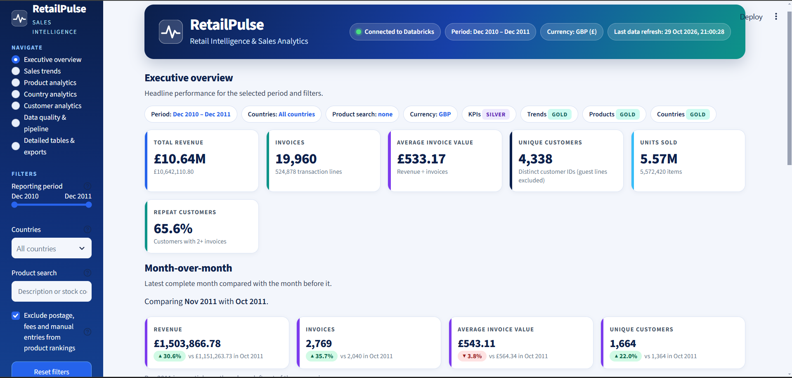
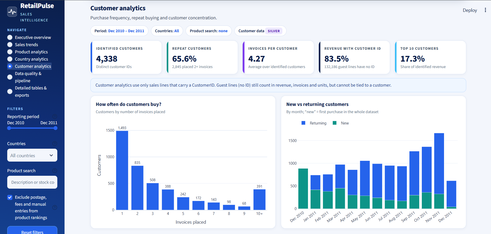
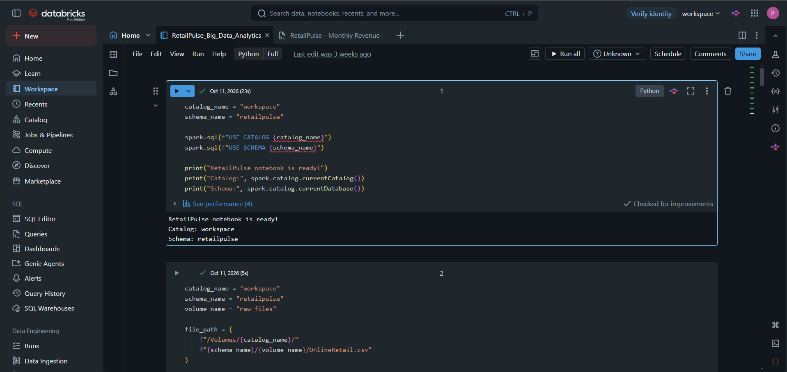
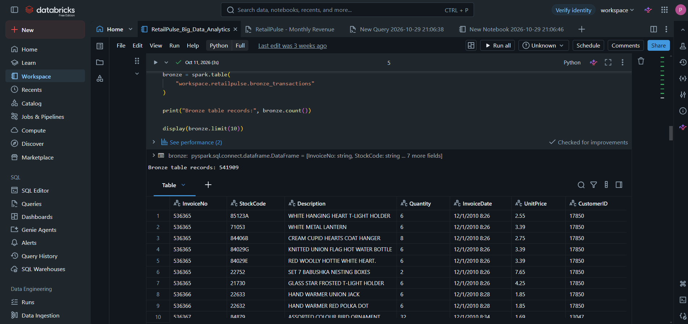
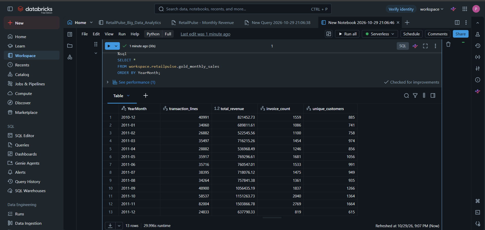

# RetailPulse — Retail Sales Intelligence Using Big Data

RetailPulse analyzes the UCI Online Retail transaction dataset using Databricks, Apache Spark/PySpark, Delta tables, SQL, Streamlit and Plotly. The dashboard presents sales trends, product and country performance, customer analytics, and data-quality/pipeline monitoring.

## Architecture

```text
UCI Online Retail source
        |
        v
Bronze Delta table (raw records)
        |
        v
PySpark standardization + rejection rules
        |                         |
        v                         v
Silver Delta table         Rejected-record audit
        |
        v
Gold monthly / product / country summaries
        |              + optional customer/cancellation summaries
        v
Databricks SQL connector (OAuth)
        |
        v
Streamlit + Plotly dashboard
```

## Existing Databricks tables

Core tables expected by the dashboard:
- `workspace.retailpulse.bronze_transactions`
- `workspace.retailpulse.silver_transactions`
- `workspace.retailpulse.gold_monthly_sales`
- `workspace.retailpulse.gold_product_sales`
- `workspace.retailpulse.gold_country_sales`

The pipeline can additionally write `silver_rejected_records`, `gold_customer_summary`, `gold_cancellations_monthly`, `data_quality_metrics`, and `pipeline_run_log`.

## Local setup (Windows PowerShell)

1. Install Python 3.10 or 3.11. PySpark Java requirements may vary by installed Spark version; install a compatible JDK if running local Spark tests.
2. Create/activate a virtual environment:

   ```powershell
   cd E:\RetailPulse
   py -m venv .venv
   .\.venv\Scripts\Activate.ps1
   pip install -r requirements.txt
   ```
3. Copy `.env.example` to `.env` and set the Databricks SQL Warehouse hostname and HTTP path. Do not commit or share `.env`.
4. Start the dashboard:

   ```powershell
   streamlit run app.py
   ```
5. Click **Connect to Databricks** and complete OAuth sign-in if prompted.

The app reads existing tables; it does not run the pipeline automatically on startup.

## Pipeline

`retailpulse_pipeline.py` contains reusable PySpark transformations and a Databricks notebook entry point. It is safe by default: `rebuild_core=False` reads existing Bronze data, computes proposed Silver/Gold data and writes the added audit/analytics tables. Only set `rebuild_core=yes` when intentionally rebuilding core Silver/Gold tables after reviewing quality checks. Review the notebook's business rules before running it on a shared workspace.

The current pipeline rules classify duplicate rows, missing required fields, cancellation invoices, non-positive quantities and non-positive prices as rejected. Returns/cancellations are therefore not included in the accepted-sales Silver output. Confirm this matches the business definition required for your analysis.

## Tests

The tests are optional and may need local dependencies and source data.

- `tests/test_pipeline_local.py` uses local PySpark and expects the source CSV at the path configured by the test (inspect the test before running; set any required environment variable accordingly).
- `tests/test_sql_duckdb.py` uses DuckDB to test SQL aggregation behavior without Databricks. Set `RETAILPULSE_CSV` to the path of the UCI CSV, then run:

  ```powershell
  $env:RETAILPULSE_CSV = "E:\path\to\OnlineRetail.csv"
  python -m pytest tests/test_sql_duckdb.py -v
  ```

These local tests do not validate Databricks OAuth, warehouse permissions, Unity Catalog access, or runtime behavior in your workspace. Those require a live connection.

## Security

- Never include `.env`, OAuth tokens, passwords, `.venv`, or `.streamlit/secrets.toml` in a shared ZIP.
- `.env.example` contains placeholders only.
- The dashboard initiates OAuth only when the user clicks the connect button.

## Known limitations

- Row-count baselines are historical reference counts and can differ if the tables or cleaning rules change. Validate live counts before reporting them.
- Optional audit/analytics tables appear only after the enhanced pipeline has been run in Databricks.
- Customer metrics depend on the availability and quality of `CustomerID`; anonymous lines remain part of sales metrics but cannot be assigned to individual customers.
- No stock-on-hand inventory or validated forecast is implemented by default.
## Project Screenshots

### Executive Overview


### Customer Analytics


### Databricks Catalog — Bronze, Silver and Gold Tables


### Bronze Transaction Data


### Monthly Sales Results
